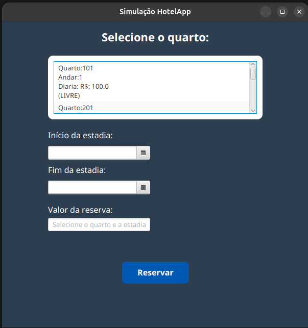
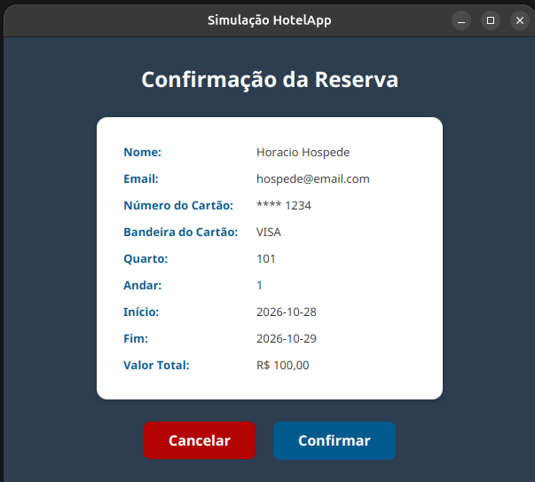
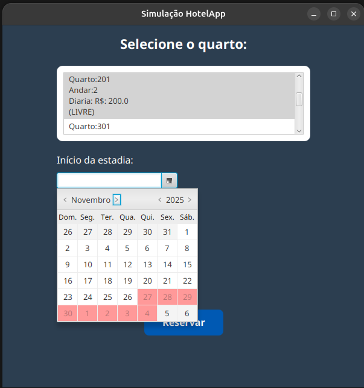
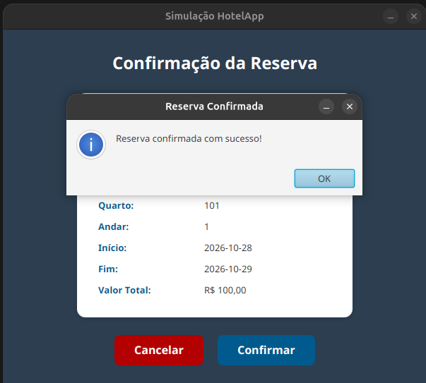
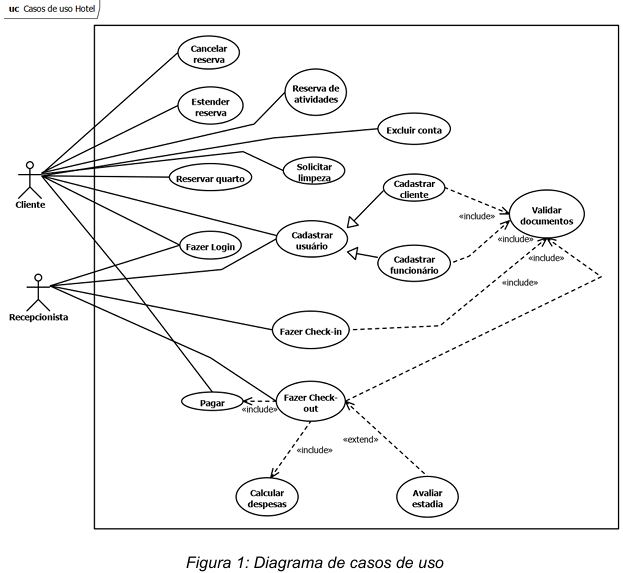
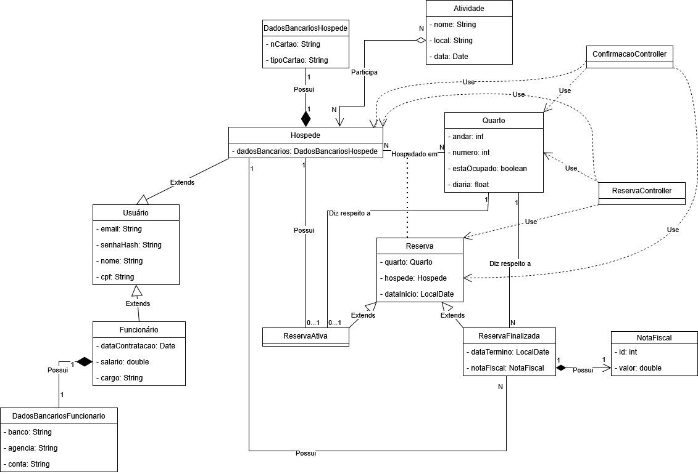
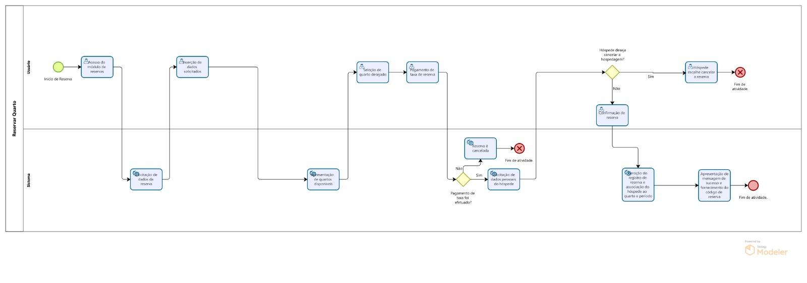

# Protótipo de reserva de hotel (IC812)

Protótipo JavaFX de reserva de quarto de hotel (simulação com dados fixos), feito para a disciplina IC812 — Análise e Projeto de Sistemas (UFRRJ), junto com o documento de requisitos da turma.

| Seleção do quarto e das datas | Confirmação da reserva |
|---|---|
|  |  |
| Quartos, datas da estadia e botão Reservar. | Hóspede, cartão, quarto, período e valor total. |

## Como executar

Requisitos: JDK 24 ou mais novo (testado com JDK 25) e Maven.

```bash
mvn clean javafx:run
```

O comando abre a janela "Simulação HotelApp" (classe `Launcher`, configurada no `pom.xml`).

<details>
<summary><strong>Mais prints do protótipo</strong></summary>



Seletor de datas do quarto 201, com os dias de uma reserva existente (27/11/2025 a 04/12/2025) destacados e bloqueados.


Mensagem "O quarto deve estar disponivel" (sem acento, como aparece na tela) ao tentar reservar o quarto 301, que está ocupado.



Janela "Reserva Confirmada", exibida depois de confirmar a reserva.

</details>

## Sobre

Este repositório reúne duas coisas distintas:

- **(a) Engenharia de requisitos**, trabalho em equipe da turma: o documento [`docs/entregafinalprojeto.pdf`](docs/entregafinalprojeto.pdf) (casos de uso, Léxico Ampliado da Linguagem e diagramas UML/BPMN).
- **(b) Protótipo JavaFX** em `src/`, feito por Davidson Wasserman: uma simulação que cobre só parte do caso de uso "Reservar quarto" (UC 005).

## Protótipo JavaFX (`src/`)

São duas telas (`reservarQuarto` e `reservarConfirmacao`). O hóspede "logado", os quartos e uma reserva existente são dados fixos no `Launcher`; nada é lido de banco ou arquivo.

### Funcionalidades

- Lista de 4 quartos com número, andar, diária e situação (livre ou ocupado).
- Escolha de data de início e de fim da estadia; os dias de uma reserva existente no quarto selecionado aparecem bloqueados no seletor de datas.
- Cálculo do valor total (dias × diária, com mínimo de 1 dia).
- Mensagens de erro: quarto não selecionado, quarto ocupado ("O quarto deve estar disponivel", sem acento), datas não informadas e data final anterior à inicial.
- Tela de confirmação com os dados do hóspede, cartão (só os 4 últimos dígitos), bandeira, quarto, andar, período (datas no formato AAAA-MM-DD) e valor total.
- Cancelar volta à primeira tela; Confirmar exibe o aviso "Reserva confirmada com sucesso!" e fecha a janela.

### Limitações

| Item | Situação |
|---|---|
| Registro da reserva (persistência) | Não há: Confirmar não cria nem guarda reserva |
| Código/número da reserva | Não há |
| Pagamento ou taxa de reserva | Não há |
| Dados pessoais do hóspede, quantidade de hóspedes e tipo de quarto | Não são solicitados; o hóspede é fixo |
| Intervalo que atravessa dias bloqueados | Sem validação: só o seletor de datas desabilita os dias |
| Demais casos de uso do PDF (UC 001–004 e 006–016) | Não implementados |
| Testes automatizados | Não há |

<details>
<summary><strong>Engenharia de requisitos (trabalho em equipe) — casos de uso, léxico e diagramas</strong></summary>

Documento produzido pela equipe, conforme a capa do PDF:

- Integrantes: Davidson Wasserman, Elias Santos, Lucas Nunes, Nicolas Duarte, Thiago Janine e Vinicius Gevu.
- Disciplina IC812 — Análise e Projeto de Sistemas, Departamento de Computação, Sistemas de Informação, UFRRJ. Professor: Eduardo Kinder Almentero. Seropédica-RJ, 2025.

### Casos de uso (16, numerados UC 001 a UC 016 no PDF)

Cada um tem objetivo, atores, fluxo principal e regras de negócio; a maioria também tem fluxos alternativos e de exceção (detalhes no [PDF](docs/entregafinalprojeto.pdf)).

1. Cadastrar Cliente
2. Cadastrar Funcionário
3. Login
4. Excluir conta
5. Reservar quarto
6. Fazer Check-In
7. Fazer Check-Out
8. Calcular despesas
9. Estender estadia
10. Reservar atividades
11. Solicitar limpeza
12. Pagar
13. Cancelar reserva
14. Solicitar serviço de quarto
15. Avaliar estadia
16. Validar Documentos

O diagrama de casos de uso (figura abaixo) mostra "Cadastrar usuário" e não mostra "Solicitar serviço de quarto" (UC 014).

### Léxico Ampliado da Linguagem

Descreve o contexto do hotel, as heurísticas e os símbolos (sujeitos, verbos, objetos e estados); texto completo nas páginas 20 a 28 do [PDF](docs/entregafinalprojeto.pdf).

### Diagramas



*Diagrama de casos de uso. Documento produzido pela equipe (ver capa do PDF).*



*Diagrama de classes. Documento produzido pela equipe (ver capa do PDF).*



*Diagrama de atividades em BPMN: Reservar quarto. Documento produzido pela equipe (ver capa do PDF).*

Outros diagramas do mesmo documento, em imagens separadas por serem largos:

- [Sequência: Reservar quarto (UC 005)](docs/img/03-sequencia-reservar-quarto.png)
- [Sequência: Fazer Check-In (UC 006)](docs/img/04-sequencia-check-in.png)
- [BPMN: Check-In](docs/img/05-bpmn-check-in.png)
- [Estados: Reserva de quarto](docs/img/07-estados-reserva-de-quarto.png)

</details>

<details>
<summary><strong>Diagrama de classes × código de <code>src/</code></strong></summary>

- **Coincidem:** `Quarto`, `Reserva`, `ReservaAtiva`, `ReservaFinalizada`, `NotaFiscal`, `Atividade`, `DadosBancariosHospede`, `DadosBancariosFuncionario` e a herança `Usuario` → `Hospede`/`Funcionario`. `ReservaController` e `ConfirmacaoController` aparecem nos dois, com relação de uso com `Quarto`, `Hospede` e reservas.
- **Senha:** o diagrama tem `senhaHash` em `Usuario`; o código tem `senha` (texto, sem hash).
- **Funcionário:** o diagrama traz `dataContratacao`, `salario` e `cargo`; no código a classe só tem os dados bancários.
- **Só no código ou só no diagrama:** `DTO` e `Launcher` existem só no código (os controllers usam `DTO` e `ReservaFinalizada`); associações do diagrama, como Hóspede–Atividade, não aparecem como campos no código.

</details>

## Tecnologias

- Java 24 (módulo `com.example.apsreservaquarto`)
- JavaFX 21.0.6 (`javafx-controls`, `javafx-fxml`), telas em FXML
- Maven e `javafx-maven-plugin` 0.0.8 (há `mvnw` na raiz)

<details>
<summary><strong>Estrutura de pastas</strong></summary>

```
.
├── pom.xml
├── docs/
│   ├── entregafinalprojeto.pdf   documento de requisitos da turma
│   └── img/                      prints do protótipo e diagramas
└── src/main/
    ├── java/com/example/apsreservaquarto/
    │   ├── Launcher.java         ponto de entrada e dados fixos
    │   ├── DTO.java              dados passados entre as telas
    │   ├── controllers/          ReservaController, ConfirmacaoController
    │   └── modelos/              classes de domínio
    └── resources/com/example/apsreservaquarto/   reservarQuarto.fxml, reservarConfirmacao.fxml
```

</details>

## Decisões de projeto

- Dados fixos criados no `Launcher`, sem banco de dados: o protótipo simula o fluxo de reserva.
- Um objeto `DTO` leva a escolha de quarto e datas da primeira tela para a de confirmação.

## Autores

- Documento de requisitos: equipe listada na capa do PDF (acima).
- Protótipo JavaFX (`src/`): Davidson Wasserman.
